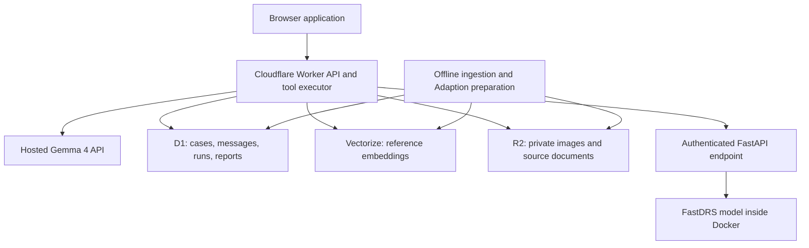

# Ijwi — architecture

Status: React landing page, Worker deployment configuration, and Gemma chat adapters implemented. Live provider credentials, deployment, screening, and durable storage remain to be verified or implemented. Canonical architecture document; updated with each feature.

## First deliverable

Deploy a Cloudflare application with persistent Gemma 4 conversations, evidence retrieval, retinal screening through a Docker service, and cited draft summaries. Target Best Use of Gemma 4 first.

## System boundary

Cloudflare owns the user-facing application and orchestration. Docker runs FastDRS inference, not Gemma. vLLM is not part of this design. Gemma uses hosted APIs with documented model defaults. Live account access, quota, and future tool-call integration must still be verified.

## Responsibilities

| Component | Responsibility |
| --- | --- |
| Browser | Case intake, image upload, conversation, source inspection, report review |
| Worker | Session authorization, validation, persistence, Gemma loop, tool execution, API responses |
| Hosted Gemma 4 | Follow-up questions, permitted tool requests, evidence-grounded explanations |
| FastAPI / Docker | Load FastDRS once at startup, apply its preprocessing, classify images |
| D1 | Structured case state and conversation/report records |
| Vectorize | Semantic retrieval over approved reference passages |
| R2 | Private image objects, source documents, dataset artifacts |
| Embedding provider | Embed corpus passages and queries with the same model/version |
| Adaption | Offline text-data preparation and augmentation; evaluation examples |

## Request flow

1. Worker creates a case scoped to a server-issued session and persists supplied history in D1.
2. Worker validates an uploaded image and stores it privately in R2. D1 stores its object key and case association.
3. An explicit screening action calls the authenticated FastDRS service with image bytes. The service returns prediction, class scores if supported, model version, and timing. Worker records the actual result.
4. Worker stores a conversation turn and loads bounded conversation context plus current case facts.
5. Worker calls Gemma with a small tool allowlist. It validates requested names, arguments, case ownership, and execution limits before running any tool.
6. Worker supplies tool results to Gemma and repeats within a bounded loop. Persist tool outcomes and the final assistant message.
7. A summary action produces a validated draft linked to its case facts, screening run, and reference passages. Human edits and review status remain separate records.

## Initial tool contracts

- `get_case`: return facts and completed screening runs for the active case.
- `search_evidence`: retrieve approved passages for a query, returning stable source/chunk IDs and source metadata.
- `get_screening_result`: read an existing run; never substitute a sample for failed inference.
- `save_draft_report`: persist schema-validated summary content with verified citation IDs. This does not mark a report reviewed.

The Worker binds the active case on the server. A model-supplied case ID cannot authorize access. Screening starts through an explicit UI action initially; optional conversational invocation can be added once upload selection and repeat-run behavior are defined.

Tool-call limits, output length, request deadlines, and per-session usage limits are configurable. Proposed starting limit: four model/tool rounds per turn, with no arbitrary SQL, shell execution, or arbitrary URL-fetch tool.

## Storage model

Proposed D1 entities: `sessions`, `cases`, `case_images`, `screening_runs`, `conversations`, `messages`, `tool_runs`, `sources`, `chunks`, `reports`, and `report_reviews`.

Records carry IDs, case/session relationships where relevant, timestamps, status, and version information. Message records distinguish user, assistant, and tool roles. Runs record failures as failures. Reports reference the screening run and cited chunk IDs.

Vectorize records contain embeddings and filterable source metadata; canonical passage text and provenance live in D1/R2. Choose an embedding model before creating the index so dimensions match. Keep reference knowledge separate from case records and synthetic examples.

## Reference ingestion and Adaption

Acquire permitted, relevant reference documents; retain their URLs, licenses, dates, and versions. Extract and chunk text, assign stable IDs, embed it, and index it. Evaluate retrieval on representative queries before claiming grounded performance.

Use the user-reported 650 Adaption credits for a small reviewed pilot followed by targeted augmentation of intake conversations, missing-information cases, and tool-use examples. Estimate cost before runs; do not assume a fixed number of rows per credit. Hold out an evaluation set and track seed lineage to avoid evaluation leakage. Synthetic outputs are labeled and are not automatically accepted as clinical evidence.

## FastDRS service

Package FastAPI and the selected FastDRS runtime in Docker. Prefer an existing working checkpoint/runtime over introducing an export task. Checkpoint availability, preprocessing, class mapping, package API, and actual prediction output must be verified.

Expose health/readiness and authenticated prediction endpoints. Readiness requires the model to be loaded. Pin dependencies and record model artifact checksum/version. Limit upload size, decoded image dimensions, concurrency, and inference duration.

The Worker reaches Docker through a stable HTTPS endpoint, either on a hosted container service or through a configured tunnel. Keep inference credentials in Worker secrets. Docker hosting remains to be selected. A laptop tunnel is suitable for a temporary demonstration only while the host remains available.

## Access and data handling

The first demonstration uses synthetic history and appropriately licensed demo images. Use scoped sessions even without a full user-account system. Authorize every case/object request. Do not expose R2 publicly or return inference-service credentials to the browser. Restrict administrative ingestion endpoints and browser origins; redact content and secrets from operational logs.

Define retention and case deletion before accepting real patient data. Deletion must cover D1 records and associated R2 objects. Retrieved content is untrusted reference text, never instructions for tool execution.

## Failure behavior

Persist enough state to retry without duplicating messages or reports. Use request/run IDs for retry handling. If Gemma fails, show a retryable conversation error. If screening fails, preserve the upload without inventing a prediction. If retrieval finds insufficient support, state that limitation.

Cached and sample responses must show provenance, model/source version, and timestamp. A replayed result is never presented as a live run. Start with straightforward requests; introduce streaming only after the complete flow works.

## Validation and delivery gates

1. Verify hosted Gemma 4 access and a real tool-call round trip from a Worker.
2. Verify FastDRS Docker inference on known test inputs and match class/preprocessing metadata.
3. Deploy Worker with D1/R2, persist a conversation, and restore it after reload.
4. Ingest a small approved corpus into Vectorize and verify retrieval/citation integrity.
5. Complete upload, real inference, conversation, and report flow; test failures and cross-session access denial.
6. Evaluate tool selection, unsupported claims, citation correctness, and missing-information handling on held-out cases. Measure end-to-end latency and report observed results.

No clinical validation, deployment, benchmark, language-quality result, or latency target is claimed as achieved by these documents.

## Repository workflow

Use `dev` as the integration branch and `feat/<scope>` for changes. Keep application implementation separate from this documentation baseline. No automatic publishing, external submission, or sponsor messaging is implied by the handoff documents.

## Previous increment: frontend implementation baseline

The landing page now uses React and Vite in `frontend/`, with TanStack Query owning API fetching, cancellation, caching, loading, and retry states. `backend/` holds the application Worker API and a Node development adapter. Vite proxies `/api` locally; the root Wrangler configuration combines the built frontend assets with the same backend handler for same-origin production requests. The health endpoint reports implemented capabilities, and preview endpoints explicitly return sample content. Gemma, FastDRS, and persistence remain future integrations.

## Tooling conventions

Use React with strict TypeScript for the frontend and pnpm for JavaScript workspace commands and dependency management. The root pnpm lockfile is authoritative; npm lockfiles are not used. Python work in the future Docker inference service uses uv, pyproject.toml, and uv.lock. Use uv add for Python dependencies and uv run for Python commands.

## Change: separate Workers and live Gemma chat

The frontend has its own `frontend/wrangler.jsonc`, with a Vite build in `frontend/dist` and a small TypeScript proxy Worker. Its `BACKEND` service binding targets `ijwi-api`. Browser requests remain same-origin at `/api/*`; provider credentials are never bundled into React. The root configuration is a compatible frontend entry point. Deploy the backend before the frontend so the service binding resolves.

The backend Worker retains preview/health endpoints and adds POST `/api/chat`. The browser sends alternating user/assistant history (up to 12 user turns, 4,000 characters per message, 16,000 total characters, 32 KiB request body). It uses TanStack Query mutation state, manual retry without automatic duplicate requests, cancellation, and an in-memory conversation. Reload clears history; D1 persistence is not implemented yet. Messages render as text rather than HTML. There are no live image, retrieval, citation, or FastDRS tools in this change.

Provider order:

1. Cloudflare Workers AI Gemma 4 through `env.AI.run`, or its REST API for Node local development with Cloudflare credentials.
2. Google Gemma 4 via `generateContent` if Cloudflare is missing, errors, times out, or returns no usable text. A provider safety block is returned directly instead of retried on another provider.

Each provider gets a 30-second deadline. REST requests are aborted at timeout; binding calls are deadline-raced because the binding has no request AbortSignal. The client allows 65 seconds for primary plus fallback. Replies include provider/model and fallback metadata; internal errors, keys, and reasoning parts are not returned. Request bodies are size-limited while reading. The backend uses an origin allowlist for optional cross-origin calls and a Cloudflare rate-limit binding (10 requests per minute per IP per Cloudflare location). This is a demo abuse control, not user authentication or a strict global quota.

`backend/.env` holds local server secrets and configuration; it is ignored. `backend/.env.example` documents all expected keys, including reserved later integrations. Frontend `.env` contains only the public optional API base URL. Python inference has its own `.env.example`. Production uses backend Worker secrets and the AI binding; GitHub must never contain real keys. The frontend explains that fallback sends the conversation to Google. Use synthetic cases during this prototype stage.

Documented model defaults: Cloudflare `@cf/google/gemma-4-26b-a4b-it`; Google `gemma-4-26b-a4b-it`. Both are configurable in backend environment settings. Configuration presence is reported by health; it is not proof of successful authentication. Live credential verification remains separate from mocked adapter tests and Wrangler dry runs.

Sources: https://developers.cloudflare.com/workers-ai/models/gemma-4-26b-a4b-it/ and https://ai.google.dev/gemma/docs/core/gemma_on_gemini_api

## Change: browser Origin handling

The frontend proxy validates browser Origin against its own public URL before forwarding API calls. It removes the already-validated Origin header on the internal service-binding request, avoiding comparison with a backend address. Foreign browser origins remain rejected at the frontend boundary; direct backend requests retain the explicit origin allowlist.

The Node development adapter adds only http://127.0.0.1:5173 and http://localhost:5173 to its local allowed origins. Vite now uses port 5173 with strictPort, so an occupied port produces an explicit error rather than silently moving to an unconfigured origin. Custom direct API frontend origins still require ALLOWED_ORIGINS. Regression coverage includes real local HTTP requests with browser Origin and production proxy validation.

## Change: low-latency Gemma generation and actionable provider failures

A live synthetic probe confirmed Cloudflare REST credentials and the configured model worked, while the previous chat request hit its 20-second deadline. The same question with chat_template_kwargs.enable_thinking=false returned a usable response in approximately 8 seconds. Cloudflare chat now explicitly disables thinking and requests up to 512 completion tokens. Google fallback uses thinkingLevel=minimal with 512 output tokens. Both providers receive 30-second deadlines and the frontend allows 65 seconds for primary plus fallback.

Errors now identify static categories (timeout, authentication/permission, quota/rate limit, unavailable model, empty answer, or request failure). If Google fallback is absent, the error says so and identifies GOOGLE_API_KEY as the required configuration. Raw provider error bodies, keys, and internal reasoning remain excluded. Local Google credentials were absent during this investigation; Google fallback remains verified with mocks only.

## Change: explicit deployment configuration selection

Root deploy scripts now select backend/wrangler.jsonc or frontend/wrangler.jsonc explicitly. Package-level deploy and dry-run scripts explicitly select their local config as well. This prevents accidental Wrangler initialization or missing-entry-point errors when configuration auto-discovery does not select the intended package. Use the repository-root scripts, or pnpm --dir with the repository's absolute path from another directory. No deployment has been performed by this change.

## Change: audience-specific conversation and readable model output

The canonical server prompt now lives in backend/src/prompt.js with version rwanda-chw-v2 and is shared by both providers. It names community health workers in Rwanda as the audience, requests plain language and normally 40–90 words, limits follow-up to one focused question, reuses known case facts, accepts unknown information, and gives short style examples. It avoids repeated disclaimer blocks and raw Markdown by default while preserving accurate capability boundaries and professional-review requirements. Prompt rules guide generation rather than guarantee compliance; live behavior and tests must be assessed separately.

AssistantMessage renders any residual Markdown through react-markdown with raw HTML skipped, no images, and only HTTP/HTTPS links. Heading sizes are normalized to the chat typography. User messages remain plain text. No string stripping or truncation changes the meaning of model output. This is display formatting, not evidence validation.
