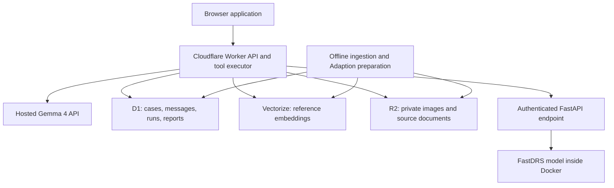

# Ijwi ry’Amaso — architecture

Status: agreed system direction, before implementation. Filename follows the requested `archtitecture.md` spelling.

## First deliverable

Deploy a Cloudflare application with persistent Gemma 4 conversations, evidence retrieval, retinal screening through a Docker service, and cited draft summaries. Target Best Use of Gemma 4 first.

## System boundary

Cloudflare owns the user-facing application and orchestration. Docker runs FastDRS inference, not Gemma. vLLM is not part of this design. Gemma uses a hosted API; the exact model ID, endpoint, quota, and tool-call behavior must be verified before the application depends on them.

## Responsibilities

| Component | Responsibility |
| --- | --- |
| Browser | Case intake, image upload, conversation, source inspection, report review |
| Worker | Session authorization, validation, persistence, Gemma loop, tool execution, API responses |
| Hosted Gemma 4 | Follow-up questions, permitted tool requests, evidence-grounded explanations |
| FastAPI / Docker | Load FastDRS once at startup, apply its preprocessing, classify images |
| D1 | Structured case state and conversation/report records |
| Vectorize | Semantic retrieval over approved reference passages |
| R2 | Private image objects, source documents, dataset artifacts |
| Embedding provider | Embed corpus passages and queries with the same model/version |
| Adaption | Offline text-data preparation and augmentation; evaluation examples |

## Request flow

1. Worker creates a case scoped to a server-issued session and persists supplied history in D1.
2. Worker validates an uploaded image and stores it privately in R2. D1 stores its object key and case association.
3. An explicit screening action calls the authenticated FastDRS service with image bytes. The service returns prediction, class scores if supported, model version, and timing. Worker records the actual result.
4. Worker stores a conversation turn and loads bounded conversation context plus current case facts.
5. Worker calls Gemma with a small tool allowlist. It validates requested names, arguments, case ownership, and execution limits before running any tool.
6. Worker supplies tool results to Gemma and repeats within a bounded loop. Persist tool outcomes and the final assistant message.
7. A summary action produces a validated draft linked to its case facts, screening run, and reference passages. Human edits and review status remain separate records.

## Initial tool contracts

- `get_case`: return facts and completed screening runs for the active case.
- `search_evidence`: retrieve approved passages for a query, returning stable source/chunk IDs and source metadata.
- `get_screening_result`: read an existing run; never substitute a sample for failed inference.
- `save_draft_report`: persist schema-validated summary content with verified citation IDs. This does not mark a report reviewed.

The Worker binds the active case on the server. A model-supplied case ID cannot authorize access. Screening starts through an explicit UI action initially; optional conversational invocation can be added once upload selection and repeat-run behavior are defined.

Tool-call limits, output length, request deadlines, and per-session usage limits are configurable. Proposed starting limit: four model/tool rounds per turn, with no arbitrary SQL, shell execution, or arbitrary URL-fetch tool.

## Storage model

Proposed D1 entities: `sessions`, `cases`, `case_images`, `screening_runs`, `conversations`, `messages`, `tool_runs`, `sources`, `chunks`, `reports`, and `report_reviews`.

Records carry IDs, case/session relationships where relevant, timestamps, status, and version information. Message records distinguish user, assistant, and tool roles. Runs record failures as failures. Reports reference the screening run and cited chunk IDs.

Vectorize records contain embeddings and filterable source metadata; canonical passage text and provenance live in D1/R2. Choose an embedding model before creating the index so dimensions match. Keep reference knowledge separate from case records and synthetic examples.

## Reference ingestion and Adaption

Acquire permitted, relevant reference documents; retain their URLs, licenses, dates, and versions. Extract and chunk text, assign stable IDs, embed it, and index it. Evaluate retrieval on representative queries before claiming grounded performance.

Use the user-reported 650 Adaption credits for a small reviewed pilot followed by targeted augmentation of intake conversations, missing-information cases, and tool-use examples. Estimate cost before runs; do not assume a fixed number of rows per credit. Hold out an evaluation set and track seed lineage to avoid evaluation leakage. Synthetic outputs are labeled and are not automatically accepted as clinical evidence.

## FastDRS service

Package FastAPI and the selected FastDRS runtime in Docker. Prefer an existing working checkpoint/runtime over introducing an export task. Checkpoint availability, preprocessing, class mapping, package API, and actual prediction output must be verified.

Expose health/readiness and authenticated prediction endpoints. Readiness requires the model to be loaded. Pin dependencies and record model artifact checksum/version. Limit upload size, decoded image dimensions, concurrency, and inference duration.

The Worker reaches Docker through a stable HTTPS endpoint, either on a hosted container service or through a configured tunnel. Keep inference credentials in Worker secrets. Docker hosting remains to be selected. A laptop tunnel is suitable for a temporary demonstration only while the host remains available.

## Access and data handling

The first demonstration uses synthetic history and appropriately licensed demo images. Use scoped sessions even without a full user-account system. Authorize every case/object request. Do not expose R2 publicly or return inference-service credentials to the browser. Restrict administrative ingestion endpoints and browser origins; redact content and secrets from operational logs.

Define retention and case deletion before accepting real patient data. Deletion must cover D1 records and associated R2 objects. Retrieved content is untrusted reference text, never instructions for tool execution.

## Failure behavior

Persist enough state to retry without duplicating messages or reports. Use request/run IDs for retry handling. If Gemma fails, show a retryable conversation error. If screening fails, preserve the upload without inventing a prediction. If retrieval finds insufficient support, state that limitation.

Cached and sample responses must show provenance, model/source version, and timestamp. A replayed result is never presented as a live run. Start with straightforward requests; introduce streaming only after the complete flow works.

## Validation and delivery gates

1. Verify hosted Gemma 4 access and a real tool-call round trip from a Worker.
2. Verify FastDRS Docker inference on known test inputs and match class/preprocessing metadata.
3. Deploy Worker with D1/R2, persist a conversation, and restore it after reload.
4. Ingest a small approved corpus into Vectorize and verify retrieval/citation integrity.
5. Complete upload, real inference, conversation, and report flow; test failures and cross-session access denial.
6. Evaluate tool selection, unsupported claims, citation correctness, and missing-information handling on held-out cases. Measure end-to-end latency and report observed results.

No clinical validation, deployment, benchmark, language-quality result, or latency target is claimed as achieved by these documents.

## Repository workflow

Use `dev` as the integration branch and `feat/<scope>` for changes. Keep application implementation separate from this documentation baseline. No automatic publishing, external submission, or sponsor messaging is implied by the handoff documents.
